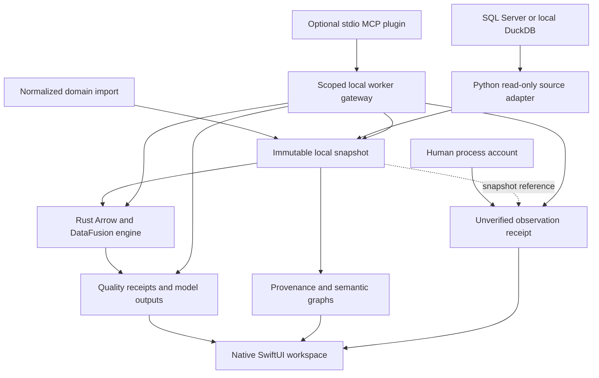
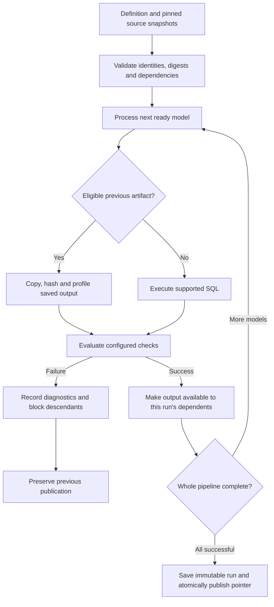
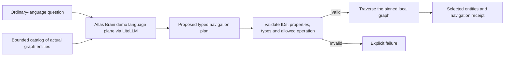

# Observatory

A native macOS workspace for understanding business data, running reproducible
transformations, and keeping evidence behind every result.

Observatory connects to a database or opens a local DuckDB file, saves a bounded
snapshot, and does subsequent analysis on local data. A SwiftUI app provides the
interface; a compiled Rust engine processes Arrow batches; Python coordinates
connectors, semantic projections and worker operations. An optional MCP plugin
makes the same local workflows available to an AI assistant.

The project started with Alberflex's migration from Logix 11 to Protheus: changes
in dimensions or finishes were creating new product codes and duplicated
engineering structures, alongside duplicate supplier accounts and payment terms.
That problem motivated a generic foundation: preserve the source records,
understand what each entity represents, and make decisions traceable to evidence.
Manufacturing is a domain pack; source connectors and the execution engine are
usable independently of TOTVS.

**Current stage:** a working local developer platform with bounded extraction,
quality checks, model pipelines, verified reuse and restoration, knowledge
navigation, human observations, and MCP tools. The longer-term goal is to retire
separate ingestion, transformation and observability tools workflow by workflow.
Full replacement depends on the [acceptance gates](docs/observatory-platform.md).

The repository also contains the original generated Python REST client and its
Rust TTALK tooling. Their API usage, generation and benchmarks are preserved in
[the Protheus client guide](docs/PROTHEUS-CLIENT.md).

## What you can do today

| Workflow | Implemented behavior |
| --- | --- |
| Connect and capture | Configure SQL Server or select an existing DuckDB database; test, discover columns and extract a bounded snapshot |
| Inspect saved data | Browse provenance, schema, row counts, null counts and a small native preview |
| Check data quality | Evaluate row-count bounds, required non-null columns and maximum null fractions against actual Parquet data |
| Transform data | Run restricted SQL models and dependency pipelines against pinned local snapshots |
| Import selected dbt workflows | Preview a supported compiled DuckDB manifest, bind its sources to snapshots, then explicitly build |
| Reuse previous work | Reuse eligible artifacts when definitions, sources, dependencies and engine identity match; verify them again |
| Restore a saved version | Inspect complete saved outputs, review the result and safely change the current pipeline version |
| Explore knowledge | Navigate an asserted graph by selection, local filtering or an Atlas Brain + LiteLLM navigation plan |
| Capture process knowledge | Preserve a person's exact account with attribution, context and snapshot references |
| Investigate manufacturing data | Review duplicate candidates, mapped family sales, supplier spend and sales exceptions from an explicitly normalized import |
| Work through an assistant | Use eleven local MCP tools scoped to a configured workspace and tenant |

## How the system works



A **snapshot** is a saved observation of a selected source at a particular time.
It carries its identity, tenant, capture time, classification, row count and
content digest. Database extracts store bulk data in Parquet. Normalized domain
imports preserve their JSON input and calculated reports. Source records retain
their original identifiers.

A **model** reads declared snapshots or upstream model outputs and produces a new
local result. A **pipeline** connects models in dependency order. A **receipt**
records what ran, the inputs and checks it used, and the observed outcome. A
small catalog pointer identifies the currently published version; older complete
runs remain available.

The implementation has distinct responsibilities:

| Component | Responsibility |
| --- | --- |
| SwiftUI | Native navigation, connection forms, snapshot selection, graph exploration, evidence views and explicit actions |
| Python worker | Database adapters, Parquet writing, domain calculations, RDF/SHACL projections, local persistence and coordination |
| Rust engine | Direct Parquet profiling, Arrow batch processing, supported quality checks, DataFusion SQL execution, artifact verification and compiled dbt import |
| MCP plugin | Protocol discovery, strict tool schemas, fixed workspace/tenant scope and bounded calls to the existing worker |

Arrow is the in-memory representation inside the Rust execution path. Parquet is
the durable local data format. Small JSON messages carry control information and
results between processes. An Arrow Flight service, an in-process Arrow C Data
bridge and end-to-end zero-copy transport remain future work.

## Extract once, investigate locally

Source access is often the scarce resource. Observatory lets quality checks,
model builds, graph exploration and saved-run verification reuse local evidence
without acquiring another source database connection.

1. Choose a table and explicit columns; set a row cap.
2. Acquire the workspace source lock and perform the bounded read.
3. Finish writing Parquet and release the source lock.
4. Profile and analyze the local artifact, then publish the completed snapshot.
5. Pin that snapshot for subsequent work. A refresh creates a new version.

The current source lock coordinates processes using the **same workspace**. An
overlapping request receives a busy error. A queue and shared lease across
workspaces accessing the same endpoint are still needed for managed acquisition.

An extract currently supports up to 100 columns and 100,000 unordered rows. Its
coverage is a bounded sample, even when the connection is live. Complete database
replication, incremental checkpoints, deletes and CDC require additional connector
work. Repeated local analysis still consumes local I/O; it does not imply a
measured performance gain or eliminate hashing and verification costs.

## Models, quality and publication

Models declare their inputs, SQL and optional quality contract. The Rust engine
accepts a supported read-query subset over authorized local inputs. It rejects
external table functions, writes and unsupported semantics. Decimal aggregation
has explicit range checks; details and examples live in the
[native runtime guide](apps/alberflex-native/README.md).



A pipeline supports up to eight sources and eight models, including imported data
tests. Models run sequentially in dependency order. A failed node blocks its
descendants; independent branches can finish diagnostics. Any failure prevents
publication of the whole pipeline and discards its candidate data files.

Quality status and execution status are separate. A successful check operation
can report a failed rule. A dataset with no configured checks is shown as
**No checks configured**. Publication does not by itself establish business
correctness.

Reuse considers the immediately previous publication in the same pipeline and
tenant. Its fingerprints include SQL, quality contracts, source snapshot IDs and
digests, dependencies and the engine executable. Reused files are copied into the
new run and checked again. If a parent rebuilds, its descendants rebuild too.
**Force rebuild** bypasses reuse. This is artifact reuse; incremental row updates,
a global cache and storage deduplication are not implemented.

The dbt path accepts a constrained **compiled manifest v12 from the DuckDB
adapter**. It supports selected compiled models and data-test behavior, with
explicit source bindings. Observatory does not execute dbt, Jinja or hooks.
Unsupported features block import readiness. A ready preview still requires a
separate build; it is not certification of an entire dbt project.

## Verify and restore a saved version

A complete historical run can become current again:

1. **Verify saved version:** Rust reads the actual output files and compares
   digests, rows, column names/types and null counts, then reruns the saved checks.
   The worker also verifies source provenance and tenant.
2. **Review:** inspect the result, original capture times and exact inspection
   digest.
3. **Make current / Restore:** reverify the target and require that the current
   catalog pointer still matches the reviewed state before replacing it.

Publication records intent and outcome in a journal. If completion is uncertain,
**Retry publication** uses the same reviewed inspection ID and digest. It can
reconcile that action without overwriting a later publication. Restoring an old
version leaves its original data age unchanged.

Unfinished staging folders are diagnostics only: they may belong to active
builds. Automatic build resumption, cross-launch journal selection in the app,
backup restoration and power-loss certification remain separate work.

## Knowledge: meaning, observations and provenance

The knowledge model distinguishes kinds of evidence instead of flattening them
into one undifferentiated graph:

| Layer | Meaning |
| --- | --- |
| TBox | Proposed vocabulary, relationships and structural constraints: what a dataset, family, configuration or event represents |
| Snapshot ABox | Assertions derived from a particular imported snapshot, with source identity and provenance |
| Event ABox | Assertions from supplied logs, retaining the fact that a log reported an event |
| Human observations | Separate immutable accounts recording what someone said, who they attributed it to and the relevant snapshot/context |

RDF named graphs preserve semantic scopes, and SHACL validates supported domain
structure. A missing assertion remains unknown. Similarity does not automatically
create an identity relation or merge ERP records. A logged update does not prove
that every real-world action was captured.

The graph can be explored through native selection and filtering. With the Atlas
Brain demo runtime configured, **Ask** uses its LiteLLM language plane:



The model proposes selection, neighbors or a bounded path. Local validation and
graph execution determine the result. Model-authored SQL, SPARQL and executable
code do not run. Navigation receipts include the graph digest, validated plan and
model usage. This is grounded navigation; governed formal business answers still
require approved mappings, ontology contracts and Atlas Brain routes.

**People can contribute without writing formulas.** For example, an operator can
record: “Changing this finish only changes the coating step.” Observatory stores
the original words and context as an **unverified** account. It does not silently
turn that statement into a proven BOM rule. Assisted interpretation, reviewed
rule creation and comparison with source evidence are planned; speech, images
and walkthrough capture are also future adapters.

LEIO Code supplies repository structure, implementation lineage and engineering
checks. Atlas Brain business assurance remains a separate contract. Local
receipts and attached tool evidence do not become signed business truth merely
because an assistant can explain them.

## The manufacturing domain pack

The [Alberflex workbench](docs/ALBERFLEX-WORKBENCH.md) operates on an explicitly
normalized input contract. It includes product/configuration and recursive
structure comparisons, supplier and payment-condition candidates, dated family
mappings, family-sales reconciliation, supplier spend and policy-based sales
exceptions.

A SKU, product family, configuration, engineering revision and BOM have different
identities. Supplier legal identity, establishment and ERP account also need to
remain distinguishable. The pack preserves those distinctions and keeps
unclassified sales visible. Reporting depends on supplied reviewed mappings and
transaction semantics; raw database columns do not acquire that meaning
automatically.

The command-line pilot also has a finite-capacity scheduling heuristic and
release-delay scenarios over supplied calendars and operations. These are
exploratory calculations with explicit assumptions. Production optimization,
validated setup/material constraints and dispatch to the plant remain future
work. No Observatory workflow writes business records to the ERP.

## Work through MCP

The [optional plugin](apps/alberflex-native/plugin/README.md) exposes eleven tools
through local stdio MCP. It provides snapshot and pipeline discovery, quality
checks, human observation capture/history, builds, inspection and restoration.
It reuses the native worker and compiled engine.

Startup fixes the workspace, tenant and runtime. Tool arguments cannot override
those choices. The gateway checks identifiers, tenant scope, file bounds and
regular paths. Results contain matching structured JSON and text; errors remain
errors. The server caps control messages, refuses overlapping operations and
terminates its owned worker process group on timeout or cancellation.

The MCP surface exposes local saved data, with no source extraction or remote
model tool. An assistant can request a build or reviewed restoration through
these explicit tools. Tool results are visible to the host and its configured
model; a local MCP server does not guarantee that the host processes them offline.

## Run the native app

Prerequisites: macOS 14+, Swift 6 tooling, Rust/Cargo, and `uv` with Python 3.13.
From the repository root:

```sh
cd apps/alberflex-native
uv venv .venv --python 3.13
uv pip install --python .venv/bin/python -e ../.. rdflib pyshacl pytest duckdb pyarrow
./script/build_and_run.sh --verify
```

This builds and launches `dist/Observatory.app`. It is a developer build tied to
this checkout. Signed, self-contained distribution remains future work.

For a first real-data session, choose an existing DuckDB file in **Connections**,
test it, discover a table, select columns and extract a Bronze snapshot. Open
**Investigations** for its measured profile and contract checks. Use **Models →
Pipelines** for a supported definition and **Knowledge** for graph exploration.
An explicitly labeled synthetic demo is available separately.

SQL Server requires the optional ADBC manager, the `mssql` driver and an authorized
read-only account. Knowledge Ask requires the separately configured Atlas Brain
demo runtime and LiteLLM. See the [native setup guide](apps/alberflex-native/README.md)
for those instructions. Connection credentials use macOS Keychain.

To use MCP, install its optional pinned SDK and configure the four variables in
the [plugin guide](apps/alberflex-native/plugin/README.md), then load the plugin in
a temporary Claude Code session. No global host registration is required by the
plugin files.

## What persists

The native workspace defaults to
`~/Library/Application Support/AlberflexObservatory`. Existing internal package and
bundle identifiers are retained for compatibility with earlier builds.

```text
workspace/
├── snapshots/               saved source artifacts, manifests and projections
├── quality-runs/            contracts and observed quality receipts
├── model-runs/              standalone model definitions and results
├── models/                  standalone model publication pointers
├── pipeline-runs/           immutable pipeline definitions, receipts and outputs
├── pipelines/               current pipeline pointers and lane locks
├── pipeline-inspections/    saved verification reports
├── pipeline-publications/   publication intent and outcome journals
├── observations/            original attributed process accounts
├── navigation/              validated graph-navigation receipts
└── graph-cache/             bounded graph projections
```

Content digests identify the bytes used in an operation. They help detect changes
and reproduce evidence; they do not certify that a source was complete or correct.
Every result keeps its scope and unsigned assurance. Synthetic fixtures remain
labeled synthetic, and failed source or model calls never substitute demo results.

## What remains to build

| Area | Next capability |
| --- | --- |
| Managed ingestion | Consistent full/incremental capture, deletes, schema drift, resumable chunks and endpoint-wide source leases |
| Larger workloads | Measured memory/throughput budgets, spill strategies and broader operator support |
| Operational reliability | Durable scheduling, backfills, cross-launch recovery UX, backup/restore and power-loss acceptance |
| Shared semantics | Visual mappings, accountable review, ontology evolution, governed formal QA and generic reconciled metrics |
| Human knowledge | Multimodal intake, inspectable interpretation, corroboration and reviewed executable checks |
| Business monitoring | Calibrated anomalies, freshness/distribution checks and permitted source-server telemetry |
| Plant decisions | Validated routing/capacity/material models, solver guarantees and authorized dispatch adapters |
| Distribution and sharing | Signed packaging, multi-user access policy and remote serving |

The storage foundation is immutable local Parquet plus manifests and JSON catalog
pointers. SQLite catalog transactions, Iceberg tables and Arrow Flight serving
are architectural options, not implemented services. Local process measurements
do not establish SQL Server memory pressure. The runtime's bounded processing
checks are not a hard operating-system RSS ceiling.

## Verification and project map

Recorded acceptance on **2026-09-06** includes 76 Rust tests and 39 Swift tests for
the native execution/recovery work, followed by a combined **191-test** Python,
workbench and MCP gate. The MCP additions include 44 gateway, 20 process-boundary
and nine actual stdio protocol tests. Strict plugin validation and LEIO Code
package checks passed. See the [acceptance record](apps/alberflex-native/SPEC.md)
for the exact sequence and limitations; this README update did not rerun code tests.

Tests create actual temporary DuckDB/Parquet artifacts with synthetic contents.
They exercise failed checks, changed files, tenant isolation, dependency failures,
publication faults and retries. Source databases are removed before selected
MCP calls to verify local-only execution. These results do not certify a live
Alberflex dataset or a representative production dbt project. Native build/launch
is verified; final visual acceptance of the latest recovery controls remains open
because the computer-use service disconnected.

To repeat the relevant checks from `apps/alberflex-native` after setup:

```sh
./script/verify_platform.sh
# Requires the optional MCP SDK:
.venv/bin/python -m pytest -c /dev/null -p no:cacheprovider worker ../../tests/workbench plugin/tests -q
claude plugin validate --strict --json plugin
```

| Path | What it contains |
| --- | --- |
| [apps/alberflex-native](apps/alberflex-native/README.md) | Native app, Python worker and standalone Rust execution crate |
| [apps/alberflex-native/plugin](apps/alberflex-native/plugin/README.md) | Local MCP server, launcher, workspace skill and protocol tests |
| [src/protheus/workbench](docs/ALBERFLEX-WORKBENCH.md) | Normalized manufacturing contracts, calculations and pilot scenarios |
| [apps/alberflex-mcp](apps/alberflex-mcp/README.md) | Separate synthetic-only interactive MCP demo |
| [docs/PROTHEUS-CLIENT.md](docs/PROTHEUS-CLIENT.md) | Original REST client and Rust TTALK tooling guide |
| [docs/observatory-platform.md](docs/observatory-platform.md) | Architecture, diagrams and workflow replacement gates |
| [apps/alberflex-native/SPEC.md](apps/alberflex-native/SPEC.md) | Detailed native behavior, constraints and delivery evidence |
